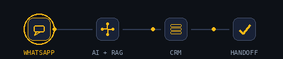
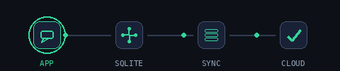
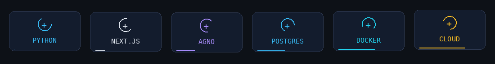
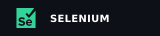
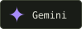
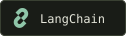
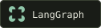
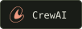
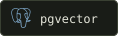
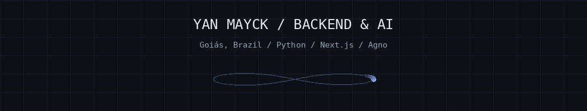

**Software Developer · Backend · Applied AI**

<a href="#projects">🚀 Products</a> &nbsp; / &nbsp; <a href="#toolbox">🧩 Technologies</a> &nbsp; / &nbsp; <a href="#code">⌨️ Public code</a>

[**My portfolio ↗**](https://yanmayck.github.io/yanmayck/)

I'm Yan, from Goiás, Brazil. Python is my main language, and I like backend development and working with AI agents. I'm in my final year of high school and plan to study Computer Science.

I built ELLOAI and CEPI Conecta, including deployment and maintenance. **Open to software development opportunities.**

## My projects

These are the two projects I spend the most time on.

<table>
<tr>
<td valign="top" width="50%" align="center">

● IN PRODUCTION &nbsp; / &nbsp; AI + WHATSAPP

<h3>ELLOAI</h3>

<strong>An AI customer service assistant for WhatsApp.</strong>

An AI assistant, CRM and business automations for WhatsApp. Learning Mode turns previous conversations into knowledge and service configuration.

I built everything, from the backend to the logo. It is the project I'm most proud of.

<code>Next.js</code> <code>Python</code> <code>Gemini</code> <code>PostgreSQL</code> <code>Redis</code> <code>Inngest</code>

</td>
<td valign="top" width="50%" align="center">

● GOOGLE PLAY &nbsp; / &nbsp; MOBILE + EDUCATION

<h3>CEPI Conecta</h3>

<strong>The app I built for my school.</strong>

Announcements, classes, calendars and family communication in an app I built for my school. Native offline support and a desktop administration panel.

Published on Google Play. Full school adoption planned for 2027.

<code>Flutter</code> <code>Dart</code> <code>SQLite</code> <code>Supabase</code> <code>PostgreSQL</code>

</td>
</tr>
</table>

<strong>ELLOAI · Technical details</strong>

- **AI that takes action:** retrieves knowledge, collects information, records sales and moves opportunities, with human approval and handoff paths.
- **Hybrid search:** combines embeddings with fuzzy name matching using PostgreSQL, pgvector and `pg_trgm`.
- **Durable processing:** orchestrates TypeScript and Python tasks through Inngest, with recovery after failures and concurrency control.
- **Operations:** atomic credit deductions, AI traces, Sentry and automated TypeScript and Python tests.

<strong>CEPI Conecta · Technical details</strong>

- **School routines:** feed, announcements, classes, calendar, timetables and notifications.
- **Families and administration:** guardian–student links, absence documentation and an administration panel adapted for desktop use.
- **Offline support in the native app:** SQLite caching and a persistent queue that retries operations when connectivity returns.
- **Delivery:** logic and widget tests, automated Android and web builds, and pipelines for database migrations and server functions.

## What I use

<strong>BACKEND & AUTOMATION</strong>

<strong>AI & DATA</strong>

KNOWLEDGE &amp; AGENT WORKFLOWS

<code>Embeddings</code> · <code>RAG</code> · <code>Hybrid search</code> · <code>pg_trgm</code> <code>Tool calling</code> · <code>Conversation memory</code> · <code>Inngest</code>

<strong>INFRA & DELIVERY</strong>

Also in my toolbox: TypeScript · React · Tailwind · shadcn/ui · Flutter / Provider Currently learning: C++

### More about the stack

<strong>🐍 Backend & automation</strong> · Python APIs, web backends and task automation.

**Python:** FastAPI, FastAPI Users, Pydantic and SQLAlchemy; previous experience with Django and Flask.

**Next.js:** Route Handlers, Server Actions, authentication and webhooks.

**Automation:** Selenium and PyAutoGUI.

**In practice:** ELLOAI started with FastAPI before I moved its main application to Next.js.

<strong>🧠 AI & agents</strong> · Agents, memory and tools.

**Frameworks:** Agno, LangChain, LangGraph, CrewAI and the OpenAI SDK.

**In practice:** Agno workflows, routing between specialized agents and PostgreSQL-backed memory in an earlier ELLOAI version.

**Current architecture:** Google GenAI SDK, hybrid RAG and durable Inngest orchestration.

**Knowledge:** embeddings and pgvector for semantic search, combined with `pg_trgm` for names and typos. Chunked indexing and history retrieval for conversation memory.

**Execution:** tool calling, agent routing, human handoff and durable Inngest steps.

<strong>📱 Web & mobile</strong> · React and Flutter.

**Web:** React, Next.js, Tailwind CSS and shadcn/ui.

**Mobile:** Flutter, Dart and Provider.

**In practice:** CEPI Conecta combines native SQLite caching and a retry queue with a desktop administration panel.

My main focus is backend and AI; frontend and mobile experience comes from building these products.

<strong>🐳 Infrastructure & delivery</strong> · Docker, Linux and deployment.

**Infrastructure:** Linux, Docker Compose and Nginx as a reverse proxy.

**Cloud:** Cloud Run, Compute Engine and Cloud Storage.

**Delivery:** GitHub Actions pipelines that build and deploy applications.

**Workflow:** Git, Bash, pnpm, uv, Nx, Postman and AI-assisted development.

## Other repositories

<table>
<tr>
<td width="50%" valign="top">
<h3>🐾 Furry Friends</h3>

Pet grooming management: clients, pets and appointments.

React · NestJS · Prisma · PostgreSQL

<a href="https://github.com/yanmayck/aplicacacao-banho-tosa-fullstak">Explore code ↗</a>
</td>
<td width="50%" valign="top">
<h3>🎓 Meta Educação</h3>

An educational platform for students and administrators.

React · Node.js · TypeScript · PostgreSQL

<a href="https://github.com/yanmayck/meta-ensino-digital">Explore code ↗</a>
</td>
</tr>
</table>

ELLOAI and CEPI Conecta have private source code. The repositories above are available to explore.

[Explore my repositories ↗](https://github.com/yanmayck?tab=repositories)

[Back to top ↑](#top)

