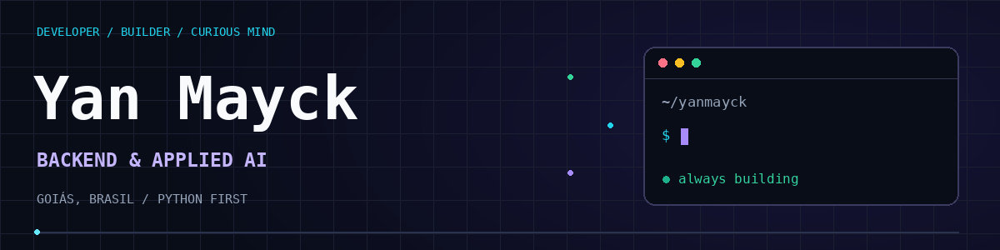
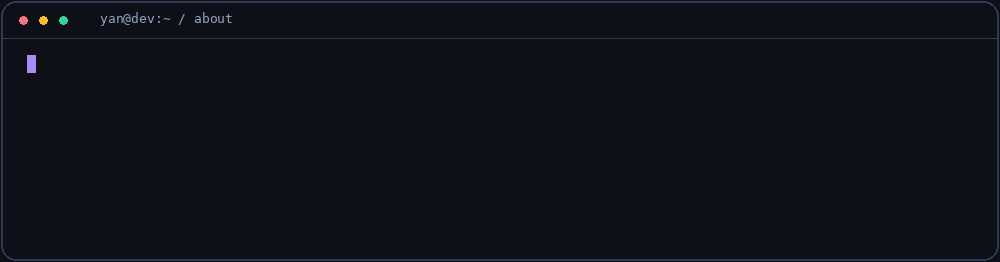

**Software Developer · Backend · Applied AI**

I'm in my final year of high school and plan to study Computer Science. In the meantime, I build and maintain my own products: an AI customer service platform and a school communication app published on Google Play.

**Open to software development opportunities**, with a focus on backend and applied AI, and hands-on experience delivering web and mobile products. I'm interested in joining a team where I can contribute what I've learned through building products and keep growing.

## Built. Shipped. Maintained.

Two products. From the first line of code to production.

<table>
<tr>
<td valign="top" width="50%" align="center">

● IN PRODUCTION &nbsp; / &nbsp; AI + WHATSAPP

<h3>ELLOAI</h3>

<strong>Your business already has a story. ELLOAI learns from it.</strong>

An AI assistant, CRM and business automations for WhatsApp. Learning Mode turns previous conversations into knowledge and service configuration.

I built the product, visual identity, application and infrastructure.

<code>Next.js</code> <code>Python</code> <code>Gemini</code> <code>PostgreSQL</code> <code>Redis</code> <code>Inngest</code>

</td>
<td valign="top" width="50%" align="center">

● GOOGLE PLAY &nbsp; / &nbsp; MOBILE + EDUCATION

<h3>CEPI Conecta</h3>

<strong>Less scattered information. A more connected school.</strong>

Announcements, classes, calendars and family communication in an app I built for my school. Native offline support and a desktop administration panel.

Published on Google Play. Full school adoption planned for 2027.

<code>Flutter</code> <code>Dart</code> <code>SQLite</code> <code>Supabase</code> <code>PostgreSQL</code>

</td>
</tr>
</table>

<strong>⚙️ Under the hood · ELLOAI</strong>

- **AI that takes action:** retrieves knowledge, collects information, records sales and moves opportunities, with human approval and handoff paths.
- **Hybrid search:** combines embeddings with fuzzy name matching using PostgreSQL, pgvector and `pg_trgm`.
- **Durable processing:** orchestrates TypeScript and Python tasks through Inngest, with recovery after failures and concurrency control.
- **Operations:** atomic credit deductions, AI traces, Sentry and automated TypeScript and Python tests.

<strong>⚙️ Under the hood · CEPI Conecta</strong>

- **School routines:** feed, announcements, classes, calendar, timetables and notifications.
- **Families and administration:** guardian–student links, absence documentation and an administration panel adapted for desktop use.
- **Offline support in the native app:** SQLite caching and a persistent queue that retries operations when connectivity returns.
- **Delivery:** logic and widget tests, automated Android and web builds, and pipelines for database migrations and server functions.

## What I build with

<strong>BACKEND & AUTOMATION</strong>

<strong>AI & DATA</strong>

<strong>INFRA & DELIVERY</strong>

Also in my toolbox: TypeScript · React · Tailwind · shadcn/ui · Flutter / Provider Currently learning: C++

<strong>🧩 Frameworks and hands-on experience</strong>

- **Python backend:** FastAPI, FastAPI Users, Pydantic and SQLAlchemy. ELLOAI originally had a FastAPI backend before I moved the main application to Next.js. I've also used Django and Flask.
- **Web applications:** Next.js Route Handlers, Server Actions, authentication and webhooks; React interfaces with Tailwind CSS and shadcn/ui.
- **Agents and AI:** experience with LangChain, LangGraph, CrewAI and the OpenAI SDK. Agno workflows and routing between specialized agents, with PostgreSQL-backed memory. In ELLOAI's current architecture, I use the Google GenAI SDK and Inngest.
- **Automation:** Selenium for browser automation and PyAutoGUI for desktop automation.
- **Mobile:** Flutter and Provider, applied in CEPI Conecta.
- **Infrastructure and cloud:** Docker Compose, Nginx as a reverse proxy, Linux, Cloud Run, Compute Engine and Cloud Storage. CI/CD pipelines that build and deploy applications.
- **How I work:** AI-assisted development, with my strongest focus on backend, AI integration and delivery; frontend and mobile experience comes from building my products.

## More experiments, more code

<table>
<tr>
<td width="50%" valign="top">
<h3>🐾 Furry Friends</h3>

Pet grooming management: clients, pets and appointments.

React · NestJS · Prisma · PostgreSQL

<a href="https://github.com/yanmayck/aplicacacao-banho-tosa-fullstak">Explore code ↗</a>
</td>
<td width="50%" valign="top">
<h3>🎓 Meta Educação</h3>

An educational platform for students and administrators.

React · Node.js · TypeScript · PostgreSQL

<a href="https://github.com/yanmayck/meta-ensino-digital">Explore code ↗</a>
</td>
</tr>
</table>

Some of my work has private source code. I'm happy to discuss architecture, technical decisions and implementation challenges while respecting user data and business information.

**From idea to deployment, I like understanding and building the whole path.**

[Explore my repositories ↗](https://github.com/yanmayck?tab=repositories)

