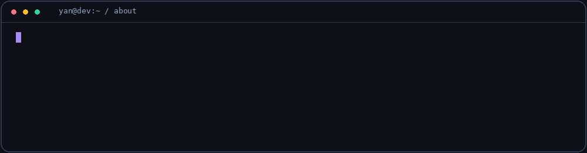

**Desenvolvedor de software · Backend · IA aplicada**

Estou no terceiro ano do ensino médio e pretendo cursar Ciência da Computação. Enquanto isso, desenvolvo e mantenho meus próprios produtos: uma plataforma de atendimento com IA e um aplicativo de comunicação escolar publicado no Google Play.

**Aberto a oportunidades em desenvolvimento de software**, com foco em backend e IA aplicada e experiência na entrega de produtos web e mobile. Tenho interesse em participar de equipes onde possa contribuir com o que já construí e continuar aprendendo.

## Ideias que saíram do papel.

Dois produtos. Do primeiro código à operação em produção.

<table>
<tr>
<td valign="top" width="50%" align="center">

● EM PRODUÇÃO &nbsp; / &nbsp; IA + WHATSAPP

<h3>ELLOAI</h3>

<strong>Seu negócio já tem uma história. A ELLOAI aprende com ela.</strong>

Atendente com IA, CRM e automações comerciais para WhatsApp. O Modo Aprendiz transforma conversas anteriores em conhecimento e configuração de atendimento.

Criei o produto, a identidade visual, a aplicação e a infraestrutura.

<code>Next.js</code> <code>Python</code> <code>Gemini</code> <code>PostgreSQL</code> <code>Redis</code> <code>Inngest</code>

</td>
<td valign="top" width="50%" align="center">

● GOOGLE PLAY &nbsp; / &nbsp; MOBILE + EDUCAÇÃO

<h3>CEPI Conecta</h3>

<strong>Menos informação espalhada. Mais escola conectada.</strong>

Avisos, turmas, calendário e comunicação com famílias em um aplicativo que construí para minha escola. Offline no app nativo e painel de gestão para computador.

Publicado no Google Play. Adoção integral pela escola planejada para 2027.

<code>Flutter</code> <code>Dart</code> <code>SQLite</code> <code>Supabase</code> <code>PostgreSQL</code>

</td>
</tr>
</table>

<strong>⚙️ Por dentro da engenharia · ELLOAI</strong>

- **IA com ações:** consulta conhecimento, coleta informações, registra vendas e movimenta oportunidades, com caminhos de aprovação e intervenção humana.
- **Busca híbrida:** combina embeddings com busca aproximada de nomes usando PostgreSQL, pgvector e `pg_trgm`.
- **Processamento durável:** orquestra tarefas entre TypeScript e Python com Inngest, com retomada após falhas e controle de concorrência.
- **Operação:** débito atômico de créditos, traces de IA, Sentry e testes automatizados em TypeScript e Python.

<strong>⚙️ Por dentro da engenharia · CEPI Conecta</strong>

- **Rotina escolar:** mural, avisos, turmas, calendário, horários e notificações.
- **Famílias e gestão:** vínculo entre responsáveis e alunos, envio de justificativas e painel administrativo adaptado para computador.
- **Uso offline no app nativo:** cache SQLite e fila persistente para reenviar operações quando a conexão retorna.
- **Entrega:** testes de lógica e widgets, automação de builds Android e web e pipelines para migrações e funções de servidor.

## O que uso para construir

<strong>BACKEND & AUTOMAÇÃO</strong>

<strong>IA & DADOS</strong>

<strong>INFRA & ENTREGA</strong>

Também na caixa de ferramentas: TypeScript · React · Tailwind · shadcn/ui · Flutter / Provider Estudando agora: C++

<strong>🧩 Frameworks e experiência na prática</strong>

- **Backend Python:** FastAPI, FastAPI Users, Pydantic e SQLAlchemy. A ELLOAI começou com backend em FastAPI antes de eu migrar a aplicação principal para Next.js. Também já trabalhei com Django e Flask.
- **Aplicações web:** Route Handlers, Server Actions, autenticação e webhooks no Next.js; interfaces React com Tailwind CSS e shadcn/ui.
- **Agentes e IA:** experiência com LangChain, LangGraph, CrewAI e SDK da OpenAI. Workflows no Agno, roteamento entre agentes especializados e memória em PostgreSQL. Na arquitetura atual da ELLOAI, uso o SDK Google GenAI e Inngest.
- **Automação:** Selenium para navegador e PyAutoGUI para desktop.
- **Mobile:** Flutter com Provider, aplicado no CEPI Conecta.
- **Infraestrutura e cloud:** Docker Compose, Nginx como proxy reverso, Linux, Cloud Run, Compute Engine e Cloud Storage. Pipelines de CI/CD que geram builds e publicam aplicações.
- **Como trabalho:** desenvolvimento com apoio de IA, com foco maior em backend, integração de IA e entrega; minha experiência em frontend e mobile vem da construção dos meus produtos.

## Mais ideias, mais código

<table>
<tr>
<td width="50%" valign="top">
<h3>🐾 Furry Friends</h3>

Gestão de banho e tosa: clientes, pets e agendamentos.

React · NestJS · Prisma · PostgreSQL

<a href="https://github.com/yanmayck/aplicacacao-banho-tosa-fullstak">Explorar código ↗</a>
</td>
<td width="50%" valign="top">
<h3>🎓 Meta Educação</h3>

Plataforma educacional para estudantes e administração.

React · Node.js · TypeScript · PostgreSQL

<a href="https://github.com/yanmayck/meta-ensino-digital">Explorar código ↗</a>
</td>
</tr>
</table>

Parte do meu trabalho tem código privado. Posso conversar sobre arquitetura, decisões técnicas e desafios de implementação sem expor dados de usuários ou informações comerciais.

**Da ideia ao deploy, gosto de entender e construir o caminho inteiro.**

[Explore meus repositórios ↗](https://github.com/yanmayck?tab=repositories)

