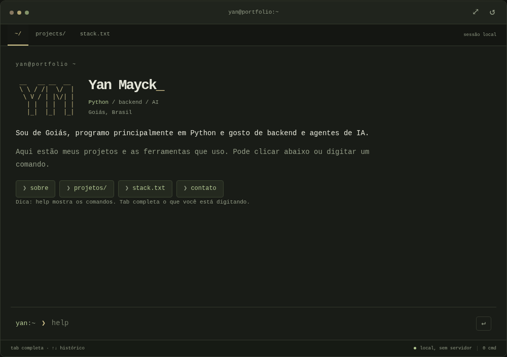
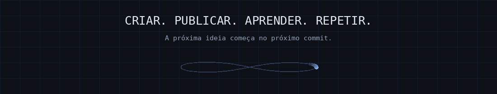

**Desenvolvedor de software · Backend · IA aplicada**

<a href="#projects">🚀 Produtos</a> &nbsp; / &nbsp; <a href="#toolbox">🧩 Tecnologias</a> &nbsp; / &nbsp; <a href="#code">⌨️ Código público</a>

<a href="https://yanmayck.github.io/yanmayck/"><strong>❯ Abrir meu terminal ↗</strong></a>

Digite um comando ou clique para navegar. <code>help</code> · <code>cd elloai</code> · <code>tree</code> · <code>theme green</code>

Sou o Yan, de Goiás. Programo principalmente em Python, gosto de backend e de trabalhar com agentes de IA. Estou no terceiro ano do ensino médio e pretendo cursar Ciência da Computação.

Criei a ELLOAI e o CEPI Conecta, cuidando também do deploy e da manutenção. **Estou aberto a oportunidades em desenvolvimento.**

## Meus projetos

São os dois projetos a que mais me dedico.

<table>
<tr>
<td valign="top" width="50%" align="center">

● EM PRODUÇÃO &nbsp; / &nbsp; IA + WHATSAPP

<h3>ELLOAI</h3>

<strong>Uma atendente com IA para WhatsApp.</strong>

Atendente com IA, CRM e automações comerciais para WhatsApp. O Modo Aprendiz transforma conversas anteriores em conhecimento e configuração de atendimento.

Fiz tudo, do backend à logo. É o projeto de que mais me orgulho.

<code>Next.js</code> <code>Python</code> <code>Gemini</code> <code>PostgreSQL</code> <code>Redis</code> <code>Inngest</code>

</td>
<td valign="top" width="50%" align="center">

● GOOGLE PLAY &nbsp; / &nbsp; MOBILE + EDUCAÇÃO

<h3>CEPI Conecta</h3>

<strong>O aplicativo que fiz para minha escola.</strong>

Avisos, turmas, calendário e comunicação com famílias em um aplicativo que construí para minha escola. Offline no app nativo e painel de gestão para computador.

Publicado no Google Play. Adoção integral pela escola planejada para 2027.

<code>Flutter</code> <code>Dart</code> <code>SQLite</code> <code>Supabase</code> <code>PostgreSQL</code>

</td>
</tr>
</table>

<strong>ELLOAI · Detalhes técnicos</strong>

- **IA com ações:** consulta conhecimento, coleta informações, registra vendas e movimenta oportunidades, com caminhos de aprovação e intervenção humana.
- **Busca híbrida:** combina embeddings com busca aproximada de nomes usando PostgreSQL, pgvector e `pg_trgm`.
- **Processamento durável:** orquestra tarefas entre TypeScript e Python com Inngest, com retomada após falhas e controle de concorrência.
- **Operação:** débito atômico de créditos, traces de IA, Sentry e testes automatizados em TypeScript e Python.

<strong>CEPI Conecta · Detalhes técnicos</strong>

- **Rotina escolar:** mural, avisos, turmas, calendário, horários e notificações.
- **Famílias e gestão:** vínculo entre responsáveis e alunos, envio de justificativas e painel administrativo adaptado para computador.
- **Uso offline no app nativo:** cache SQLite e fila persistente para reenviar operações quando a conexão retorna.
- **Entrega:** testes de lógica e widgets, automação de builds Android e web e pipelines para migrações e funções de servidor.

## O que eu uso

<strong>BACKEND & AUTOMAÇÃO</strong>

<strong>IA & DADOS</strong>

<strong>INFRA & ENTREGA</strong>

Também na caixa de ferramentas: TypeScript · React · Tailwind · shadcn/ui · Flutter / Provider Estudando agora: C++

### Mais sobre a stack

<strong>🐍 Backend & automação</strong> · APIs Python, backend web e automação de tarefas.

**Python:** FastAPI, FastAPI Users, Pydantic e SQLAlchemy; experiência anterior com Django e Flask.

**Next.js:** Route Handlers, Server Actions, autenticação e webhooks.

**Automação:** Selenium e PyAutoGUI.

**Na prática:** a ELLOAI começou com FastAPI antes de eu migrar a aplicação principal para Next.js.

<strong>🧠 IA & agentes</strong> · Agentes, memória e ferramentas.

**Frameworks:** Agno, LangChain, LangGraph, CrewAI e SDK da OpenAI.

**Na prática:** workflows no Agno, roteamento entre agentes especializados e memória em PostgreSQL em uma versão anterior da ELLOAI.

**Arquitetura atual:** SDK Google GenAI, RAG híbrido e orquestração durável com Inngest.

<strong>📱 Web & mobile</strong> · React e Flutter.

**Web:** React, Next.js, Tailwind CSS e shadcn/ui.

**Mobile:** Flutter, Dart e Provider.

**Na prática:** o CEPI Conecta combina cache SQLite e fila de reenvio no app nativo com um painel de administração para computador.

Meu foco maior é backend e IA; a experiência em frontend e mobile vem da construção desses produtos.

<strong>🐳 Infra & entrega</strong> · Docker, Linux e deploy.

**Infraestrutura:** Linux, Docker Compose e Nginx como proxy reverso.

**Cloud:** Cloud Run, Compute Engine e Cloud Storage.

**Entrega:** pipelines no GitHub Actions que geram builds e publicam aplicações.

**Rotina:** Git, Bash, pnpm, uv, Nx, Postman e desenvolvimento com apoio de IA.

## Outros repositórios

<table>
<tr>
<td width="50%" valign="top">
<h3>🐾 Furry Friends</h3>

Gestão de banho e tosa: clientes, pets e agendamentos.

React · NestJS · Prisma · PostgreSQL

<a href="https://github.com/yanmayck/aplicacacao-banho-tosa-fullstak">Explorar código ↗</a>
</td>
<td width="50%" valign="top">
<h3>🎓 Meta Educação</h3>

Plataforma educacional para estudantes e administração.

React · Node.js · TypeScript · PostgreSQL

<a href="https://github.com/yanmayck/meta-ensino-digital">Explorar código ↗</a>
</td>
</tr>
</table>

O código da ELLOAI e do CEPI Conecta é privado. Os repositórios acima estão disponíveis para explorar.

[Explore meus repositórios ↗](https://github.com/yanmayck?tab=repositories)

[Voltar ao início ↑](#top)

